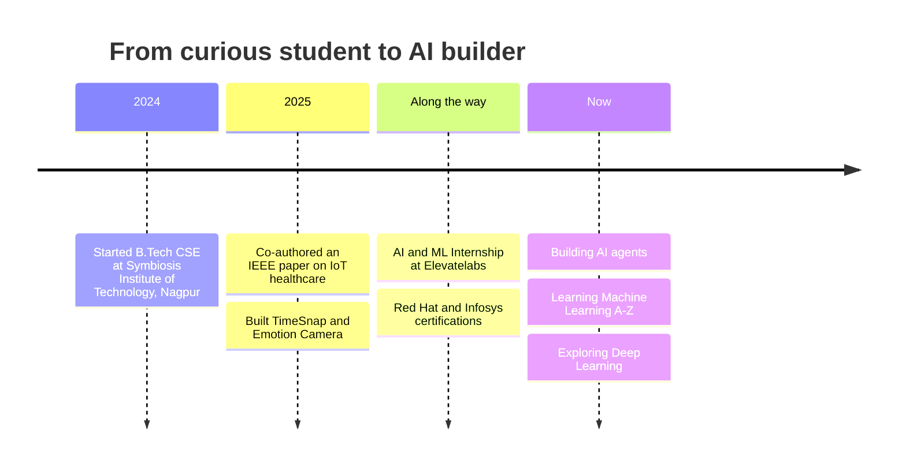

<div align="center">


[](https://git.io/typing-svg)

<br>


</div>

<br>

```bash
sameera@github:~$ whoami
> Sameera Bhoyar | B.Tech CSE @ Symbiosis Institute of Technology, Nagpur

sameera@github:~$ cat mission.txt
> Build AI that is useful, private, and human-friendly.

sameera@github:~$ ls achievements/
> 📄 IEEE-published-paper    🤖 AI-ML-internship    🏆 3-shipped-projects    🎓 5-certifications

sameera@github:~$ echo $CURRENT_QUEST
> Leveling up in Deep Learning, one neural network at a time 🧠

sameera@github:~$ _
```

<br>

## ⚡ Impact in Numbers

<div align="center">

| 🎯 **90%** | ⏱️ **~80%** | ⚡ **<100ms** | 🎭 **7** | 📄 **IEEE** |
|:---:|:---:|:---:|:---:|:---:|
| timetable extraction accuracy in TimeSnap | planning time saved | emotion detection latency | emotions recognised live | peer-reviewed publication |

</div>

<br>

## 🚀 Featured Projects

<div align="center">

<a href="https://github.com/SAMeerAbhoyar/government-scheme-agent">
  
</a>
<a href="https://github.com/SAMeerAbhoyar/DeepNext">
  
</a>
<a href="https://github.com/AtharvaMeharkure/timesnap">
  
</a>

</div>

<br>

<details open>
<summary><b>🏛️ Government Scheme Agent</b>: AI that connects people to the schemes meant for them</summary>
<br>

Millions of people miss out on government benefits simply because they never find out they qualify. This AI agent bridges that gap by helping users discover schemes that match their situation.

**Why it matters:** technology that serves real citizens, not just demos.

[](https://github.com/SAMeerAbhoyar/government-scheme-agent)

</details>

<details open>
<summary><b>⏰ TimeSnap</b>: snap your timetable, get a smart schedule</summary>
<br>

Point it at a timetable and AI turns it into a clean, organised schedule with real-time reminders. Works **offline** and syncs to the **cloud**.

- 🧠 **90%** extraction accuracy &nbsp;|&nbsp; 📉 **~80%** less planning time
- 🛠️ React • Node.js • Firebase • Gemini API

[](https://github.com/AtharvaMeharkure/timesnap)

</details>

<details open>
<summary><b>🧬 DeepNext</b>: my deep learning lab</summary>
<br>

Where I push beyond tutorials: neural networks, experiments and the next step in my deep learning journey.

[](https://github.com/SAMeerAbhoyar/DeepNext)

</details>

<details>
<summary><b>🎭 Emotion Camera</b>: a browser that reads your mood (click to expand)</summary>
<br>

A real-time **emotion-to-action camera**. It detects 7 emotions through your webcam and triggers actions like playing music on Spotify or logging to Notion.

- 🔒 **100% client-side**, so your face never leaves your device
- ⚡ **<100ms** latency with zero server cost
- 🎚️ 10-second action cooldown with live confidence tracking
- 🛠️ React • face-api.js • Vercel CI/CD

</details>

<details>
<summary><b>🩺 IoT Health Monitor</b>: a guardian for patients (click to expand)</summary>
<br>

A real-time patient monitoring system that tracks heart rate and temperature, supports remote monitoring, and sends smart alerts for early detection of health issues. It became my **IEEE publication**.

</details>

<br>

## 🗺️ My Journey



<br>

## 📄 Published Research

<div align="center">

> ### *"Revolutionizing Healthcare: IoT-Enabled Continuous Health Monitoring Devices for the Future"*
> 🏛️ **IEEE** · 2025 12th International Conference on Emerging Trends in Engineering & Technology (ICETET-SIP), Nagpur
>
> [](https://doi.org/10.1109/ICETETSIP64213.2025.11156320)

</div>

<br>

## 🧰 Tech Arsenal

<div align="center">


<br>


</div>

<br>

## 🎓 Learning Quest

```text
Machine Learning A-Z (Udemy)        [██████████░░░░░░░░░░]  in progress 🔥
Deep Learning & Neural Networks     [████████░░░░░░░░░░░░]  exploring 🧠
DSA with Python & Java              [████████████░░░░░░░░]  leveling up ⚔️
```

<details>
<summary><b>🏅 Certifications (click to expand)</b></summary>
<br>

- 🐧 **Red Hat System Administration I (RH124 v10)**: Red Hat Training
- 🐍 **Introduction to Python Programming (AD141)**: Red Hat Training
- 🧮 **Data Structures and Algorithms using Python, Part 1**: Infosys Springboard
- 💻 **Programming in C**: Infosys Springboard

</details>

<br>

## 📊 GitHub Analytics

<div align="center">


</div>

<br>

## 🧊 3D Contribution Graph

<div align="center">


</div>

<br>

## 🤝 Let's Build Something Together

<div align="center">

I'm open to **AI/ML projects, hackathons, internships and collaborations**.
Got an idea? Let's make it real. 🚀

<br>

[](https://www.linkedin.com/in/sameera-bhoyar-a48394307)
[](mailto:sameerabhoyar009@gmail.com)

<br>

*"The best way to predict the future is to train it."* 🤖


</div>
