


 

  

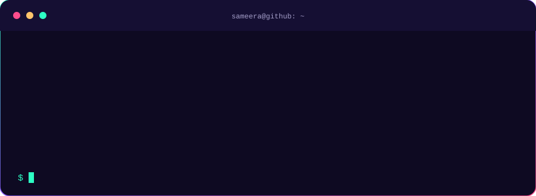

  

 
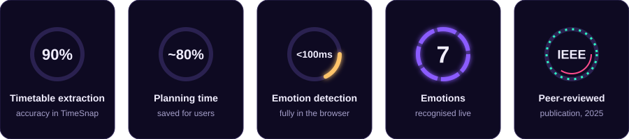

  

 

<a href="https://github.com/SAMeerAbhoyar/government-scheme-agent"></a>
<a href="https://github.com/AtharvaMeharkure/timesnap"></a>
 
<a href="https://github.com/SAMeerAbhoyar/DeepNext"></a>
<a href="https://github.com/SAMeerAbhoyar/shc-interpreter"></a>

  

 
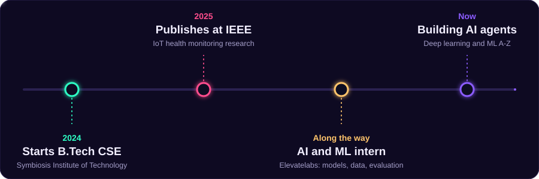

  

 
<a href="https://doi.org/10.1109/ICETETSIP64213.2025.11156320">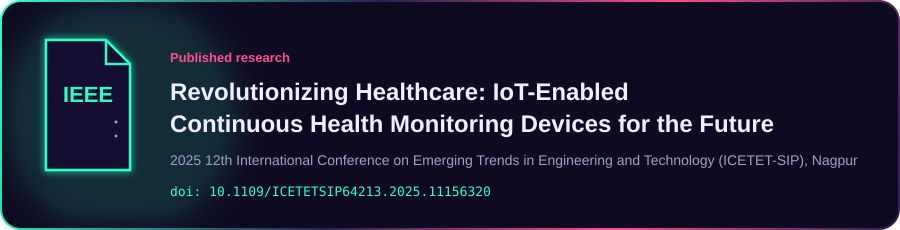</a>

  

 
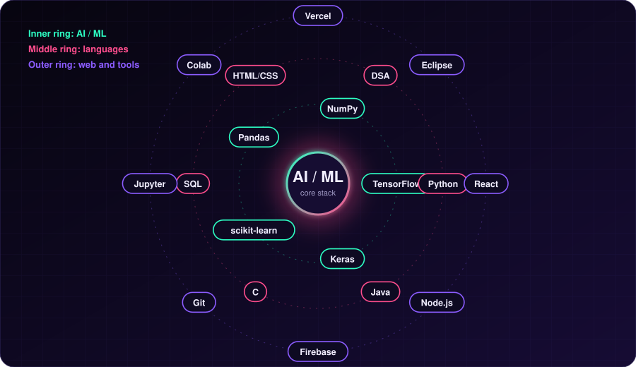
 

  

 
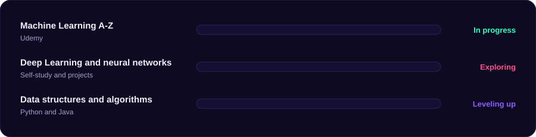

<b>Certifications (click to open)</b>

 

- Red Hat System Administration I (RH124 v10), Red Hat Training
- Introduction to Python Programming (AD141), Red Hat Training
- Data Structures and Algorithms using Python, Part 1, Infosys Springboard
- Programming in C, Infosys Springboard

 

 

 

 

 

  

 
<a href="https://www.linkedin.com/in/sameera-bhoyar-a48394307">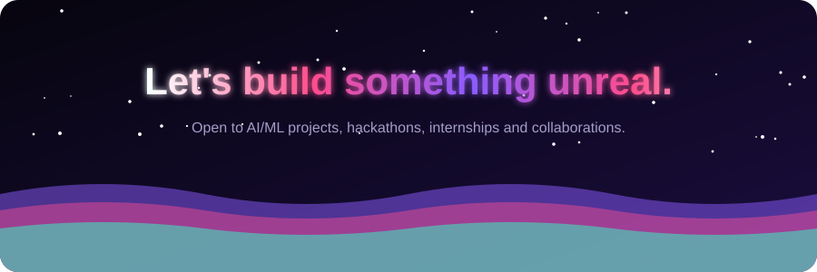</a>

