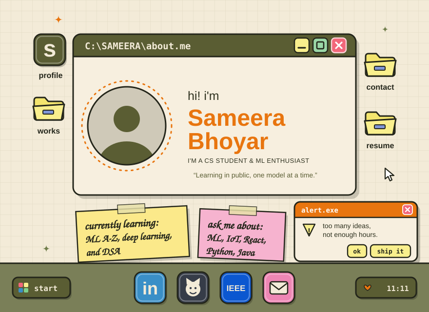
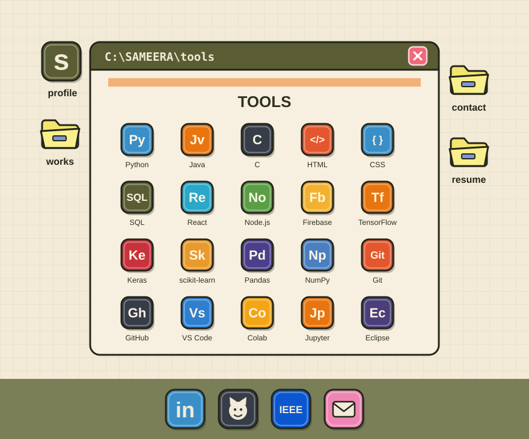
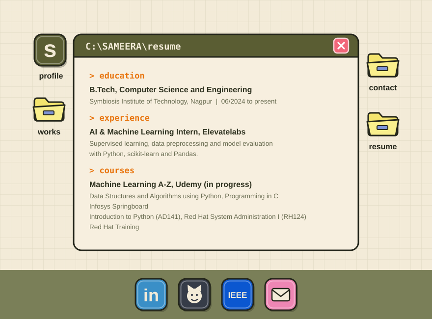
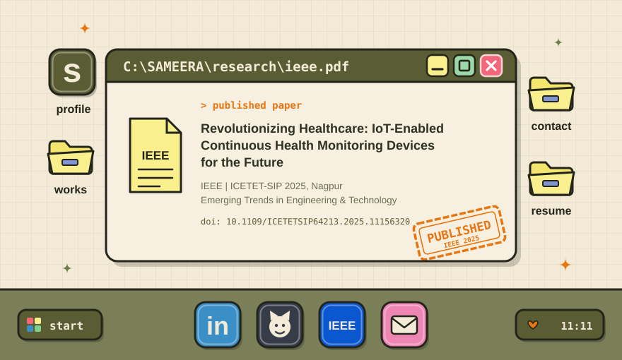
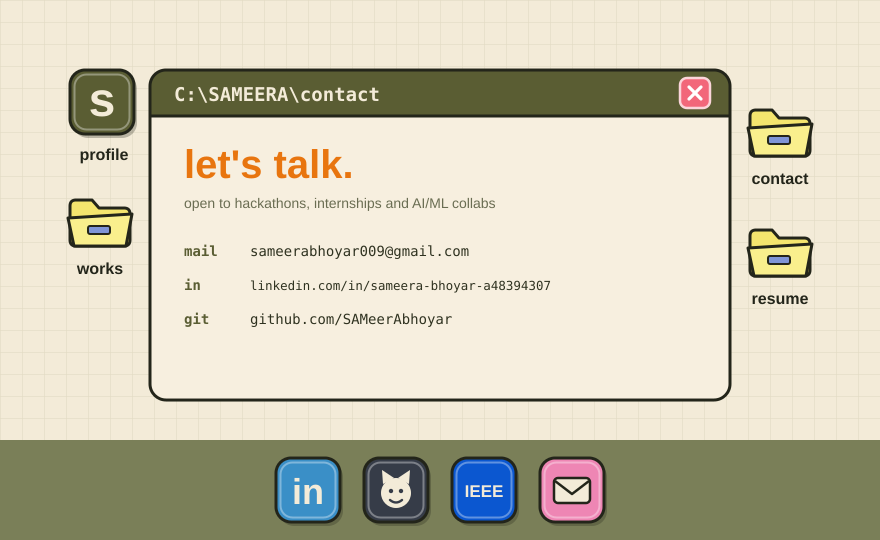

<table>
<tr>
<td></td>
<td></td>
</tr>
<tr>
<td></td>
<td></td>
</tr>
</table>

[LinkedIn](https://www.linkedin.com/in/sameera-bhoyar-a48394307) &nbsp;|&nbsp; [Email](mailto:sameerabhoyar009@gmail.com) &nbsp;|&nbsp; [IEEE paper](https://doi.org/10.1109/ICETETSIP64213.2025.11156320)

